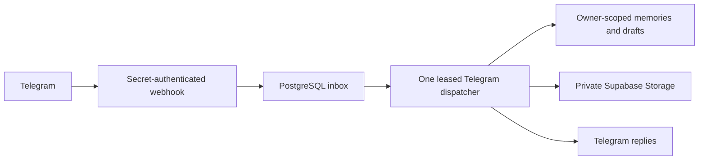

# Memo: Render Free webhook pilot

This is a small, demonstrable pilot, not an always-on or production-scale capacity claim.
The proposed resources are one Render **Free Web Service** and the existing Supabase
project **my-customers**, confirmed project reference `verhllnqohsdypbyyeib`.
There is no paid worker, Redis service, persistent Render disk or additional Supabase
project. Supabase and AI usage must remain within the account's existing quotas;
`plan: free` does not guarantee unlimited storage, AI usage or uptime.

## Architecture audit

Baseline: repository `Zion-123456/Memo-SWEP-Bot`, commit
`1dec7701b8a9de73896b7babbe1e1e07b7cda1ea`. The checkout's original branch was `work`.
Pilot changes are on `pilot/render-free-webhooks`; `main` is not modified.

| Area | Baseline assessment and evidence | Pilot implementation |
| --- | --- | --- |
| Startup | FastAPI `main.py` and `app/factory.py` initialized PTB and started long polling | FastAPI starts a PostgreSQL-backed webhook dispatcher; no polling |
| Telegram UX | `/start` response observed in the temporary polling process; long SWEP onboarding | Short personal `/start`; optional `/legacy_setup`; existing menus retained |
| Capture | Text, voice, photo, document handlers and existing tests; no user-review transaction | Persistent preview, edit, confirm/cancel, original evidence and bounded media processing |
| Check-ins | Missing | Owner-scoped PostgreSQL drafts, skip/done/resume, deduplicated answers |
| Projects | Missing | Default life areas, create/rename/archive, draft assignment and filtered search |
| Retrieval | Implemented, but an empty search could fall back to unrelated records | Empty matches stay empty; dates, project filters, sources and reviewed text are preserved |
| Redis | Required conversation persistence; temporary onboarding fields; temporary poller lease and worker heartbeat | PostgreSQL state/inbox/dispatcher lease; readiness replaces the heartbeat; no runtime Redis dependency |
| Files | `data/uploads` or `UPLOAD_DIR`; Docker `/app/data/uploads`; local files are not durable on Render Free | Private Supabase Storage with authenticated server-side access and checksums |
| Privacy | Unauthenticated REST data endpoints | Data endpoints fail closed in production; Telegram access is owner-scoped and private-chat only |



Redis never held the saved memories or check-in drafts. Old Redis conversation
state and onboarding fields still require copying where they exist. The optional
legacy importer preserves the source and never overwrites newer PostgreSQL state.
The legacy Redis client is now a development/tooling dependency only.

Persistent data now belongs in the isolated `memo` PostgreSQL schema and the private
`memo-private` bucket. Do not add that schema to public PostgREST exposure or put
service-role credentials in a client. Use a database role scoped to Memo's schema.
Original SWEP columns remain; the personal workflow makes those fields optional.

## Exact Render configuration

Review [render.yaml](../render.yaml). Its native Python build and startup commands are:

```bash
pip install --upgrade pip==26.2.2 && pip install poetry==2.5.1 && poetry install --only main --no-interaction
poetry run uvicorn main:app --host 0.0.0.0 --port $PORT --workers 1 --no-access-log
```

The Python version is pinned to 3.12.14. The tracked Poetry lockfile is used by both
Render and the optional Docker build. Build commands do not run migrations.
`autoDeploy: false` prevents Git pushes from automatically deploying this Blueprint.
Use the pilot branch when reviewing the service source.

| Variable | Purpose and source |
| --- | --- |
| `PYTHON_VERSION=3.12.14` | Native Render runtime; both Docker stages use the same patch release |
| `POETRY_VIRTUALENVS_IN_PROJECT=true` | Keeps the native build/runtime environment in the project |
| `APP_ENV=production` | Enforces private storage and disables unauthenticated data APIs |
| `DATABASE_URL` | Protected PostgreSQL connection from the existing project's Connect settings; never invent or paste it in chat |
| `DATABASE_SCHEMA=memo` | Isolates Memo from existing customer tables |
| `SUPABASE_PROJECT_REF=verhllnqohsdypbyyeib` | Confirmed project identity; must match both database and Storage |
| `SUPABASE_URL=https://verhllnqohsdypbyyeib.supabase.co` | Existing project's API base URL |
| `SUPABASE_SERVICE_ROLE_KEY` | Protected server-only credential for the private Storage API |
| `SUPABASE_STORAGE_BUCKET=memo-private` | Proposed private bucket; inspect existing buckets and obtain approval before creating it |
| `STORAGE_PROVIDER=supabase` | Required for production; no persistent local uploads on Render Free |
| `TELEGRAM_BOT_TOKEN` | Protected credential for `@use_memo_bot` |
| `TELEGRAM_WEBHOOK_SECRET` | Render-generated secret; validated in `X-Telegram-Bot-Api-Secret-Token` |
| `RENDER_EXTERNAL_URL` | Render supplies the actual public service URL automatically |
| `PORT` | Render supplies the listener port automatically; consumed by the start command |
| `PUBLIC_BASE_URL` | Optional HTTPS override for a custom public host; omit to use Render's supplied URL |
| `REGISTER_WEBHOOK=false` | Safe preparation default in code and Blueprint; change to `true` only after explicit approval to register the live endpoint |
| `AI_ENABLED=true` | Enables the existing configured AI provider; may be false for text-only operation |
| `GROQ_API_KEY` | Protected provider credential; needed for AI and voice transcription |
| `GROQ_MODEL` | Default `openai/gpt-oss-120b`; verify account quota/access |
| `GROQ_TRANSCRIPTION_MODEL` | Default `whisper-large-v3` |
| `MEMO_DB_POOL_SIZE=2`, `MEMO_DB_MAX_OVERFLOW=2` | Small connection budget for the pilot |
| `RUN_MIGRATIONS=false` | Keeps migrations out of automatic startup |
| `MEMO_MIGRATION_APPROVED` | Temporary operator-only guard for an explicitly approved production migration/copy; never enable it permanently |

No `REDIS_URL` is required by the web service. A session-pooler connection from the
existing Supabase project is preferable when its direct database endpoint is
IPv6-only or unreachable. Do not guess the pooler hostname, user or password.
Keep TLS enabled; `postgresql://...?...sslmode=require` is normalized for asyncpg.

## Inspection and approval gates

Nothing in this branch creates infrastructure, a bucket or a production schema.
No production deployment or migration has been performed.

1. Confirm the protected database and service-role bindings match only the project
   above. Superseded project references must not be used for this pilot.
2. Enable the workspace's supported HTTPS route to
   `verhllnqohsdypbyyeib.supabase.co` and its supported TCP route to the actual host
   in `DATABASE_URL`. The current workspace proxy rejected the HTTPS route, and
   its TCP grant list is empty. Use configured proxy/trust support; do not bypass it.
3. Run read-only metadata inspection with the secure environment already loaded:

   ```bash
   python -m app.ops.inspect_database
   ```

   Review schemas, table names and any existing Memo tables before proposing a
   production migration. The project display name must also be checked in Supabase.
   A service-role key alone does not provide a PostgreSQL connection or TCP route.
4. Inspect Storage buckets read-only. No bucket has yet been confirmed. Approve a
   private bucket only after that inspection; never reuse a public bucket for
   private evidence. Apply a 20 MB file limit. No malware-scanning service has been
   integrated; retained files must not be executed or publicly served.
5. Preserve and back up existing Memo database rows, legacy Redis state and local
   uploads before migration. If Memo already exists in `public`, review a specific
   schema/data move; do not blindly create empty duplicate tables in `memo`.
6. Only after target inspection, backup and explicit approval, prepare the Memo
   schema with appropriate permissions and apply reviewed Alembic migrations once:

   ```bash
   MEMO_MIGRATION_APPROVED=true poetry run alembic upgrade head
   ```

   This guard is not permission to change production. Free Render does not need a
   paid pre-deploy command or worker: run the approved migration from an authorized
   operator environment with database access. An offline SQL script can be
   generated for review using `alembic upgrade head --sql`; it does not connect or
   apply changes. Its schema must already have been approved and created.
7. Copy available legacy state and files before retiring the old runtime. Both
   tools default to dry-run and preserve originals:

   ```bash
   python -m app.ops.import_redis_state
   python -m app.ops.migrate_storage
   ```

   The Redis importer needs the source `REDIS_URL` and a tooling installation that
   includes the dev Redis client. The file importer needs `LEGACY_UPLOAD_DIR` on
   the machine that still holds the originals. Review results, then use `--apply`
   only with approval. Private copies are read back and hashed before database
   references change. Reruns skip copied references. Do not remove originals until
   end-to-end retrieval and the rollback window have been verified.
8. Review the Free service, its branch, environment and bucket; obtain deployment
   approval, including explicit permission to set `REGISTER_WEBHOOK=true`.
   Stop the old poller before switching. Startup refuses to silently
   replace a different existing webhook URL and never drops pending Telegram updates.

## Delivery, recovery and monitoring

`POST /telegram/webhook` rejects a missing/incorrect secret with 403. Valid updates
are acknowledged only after PostgreSQL commit. Duplicate update IDs reuse the
receipt. Database failures return 503 so Telegram can retry. Slow AI, downloads and
handlers do not run inside the HTTP acceptance request.

A renewable PostgreSQL lease selects one dispatcher. A new receiver can accept
updates durably while the previous deployment drains. Conversation state is loaded
only after acquiring that lease. Per-chat ordering is preserved across retries;
another chat can proceed while one update backs off. Failed work gets at most five
dispatch attempts, then remains visible as a failed inbox row for operator review.
Completed receipts clear their private payload; failed payloads are retained for
recovery. Do not dump those payloads into logs or reports.
The lease is renewed during startup as well as dispatch. Construction or shutdown
failures release it; after an abrupt process kill, takeover may wait for the
90-second lease expiry. This can add to a Render cold-start delay.

Memory confirmation is protected by an owner-scoped row lock and returns the same
record when retried. External Telegram replies have at-least-once delivery semantics;
a crash after sending a reply can produce a duplicate reply. No distributed system
claim of exactly-once external messages is made.

Original attachment references are committed before download/transcription. Uploaded
originals are committed before interpretation. Interrupted processing reopens the
draft with an honest retry state. Voice/PDF failures retain the source; previews
must be reviewed before confirmation. Extracted previews are limited to 20,000
characters; full originals remain private. Media work is bounded to four tasks;
AI interpretation is bounded separately, with pending events retained in PostgreSQL.
No OCR, engagement features, streak display or mentorship sharing has been added.

| Endpoint | Contract |
| --- | --- |
| `/live` | Process liveness, independent of downstream services |
| `/api/v1/ready` | 200 only when database, Telegram initialization, dispatcher task and private storage are ready; otherwise 503 |
| `/api/v1/health` | Legacy JSON health report; inspect its status field rather than assuming every 200 means ready |

Watch Render logs for `webhook.host_ready`, `webhook.dispatch_failed`,
`webhook.lease_lost`, and `webhook.dispatcher_stopped`. Inspect inbox counts by state
without exposing payloads. Render Free may sleep when idle; cold starts and Telegram
retries can delay responses. PostgreSQL preserves accepted work across sleep/restart,
but this does not make the Free plan always-on. Do not add artificial keepalive pings
or claim paid-service availability. Set a short, supervised director-demo window.

## Backup, rollback and smoke test

Use the existing project's authorized database export/backup process for the `memo`
schema, plus a private export of its Storage objects and their checksums. Preserve
legacy file archives until retrieval has been verified. Test restoration in a
separate safe database/bucket before any production cutover. Keep backups outside
Git with restricted access. No Supabase backup or restore has yet been performed.

Local evidence includes restoring a PostgreSQL archive to an isolated database,
applying migrations, and comparing existing local records unchanged. Full migrations
also ran in a fresh isolated schema while preserving public table membership.
Private file-copy tests verify bytes, retained originals and idempotent reruns using
a simulated remote store. These checks are not proof of a live Supabase restore.

Rollback the service to a compatible previous application revision; keep the
additive tables and files. Migrations 0005/0006 refuse automatic destructive downgrade.
Do not reset the database or restore over newer records. A data rollback needs a
reviewed restore/reconciliation plan. Restoring an old poller requires an approved
webhook cutover; do not run it alongside the webhook deployment.

After an approved deployment:

1. Verify `/live` and `/api/v1/ready`, then inspect `getWebhookInfo` without exposing
   its URL secret or bot token. The expected path is `/telegram/webhook`.
2. Send `/start` to `@use_memo_bot`; verify short personal setup and the menu.
3. Send a distinctive text, edit and confirm it, then search for the reviewed text.
4. Create a project, associate a draft and search/browse that project's records.
5. Start a check-in, answer/skip, restart the service, `/resume`, edit and confirm.
6. Send a real voice note and PDF/photo; verify the preview, cancellation/retry and
   original-evidence retrieval. Confirm they remain retrievable after redeployment.
7. Replay an update in a safe test environment and confirm one saved record; verify
   another account cannot read, modify or delete that record.
8. Review failed inbox rows and provider quotas, then make the pilot GO/NO-GO decision.

Live webhook delivery, live Supabase private storage, the actual Render Free service
and Supabase migration/backup remain unverified until the gates above are completed.

Use [the director-demo checklist](director-demo-checklist.md) to record approval,
the read-only inspection evidence and the results of each live smoke test.
